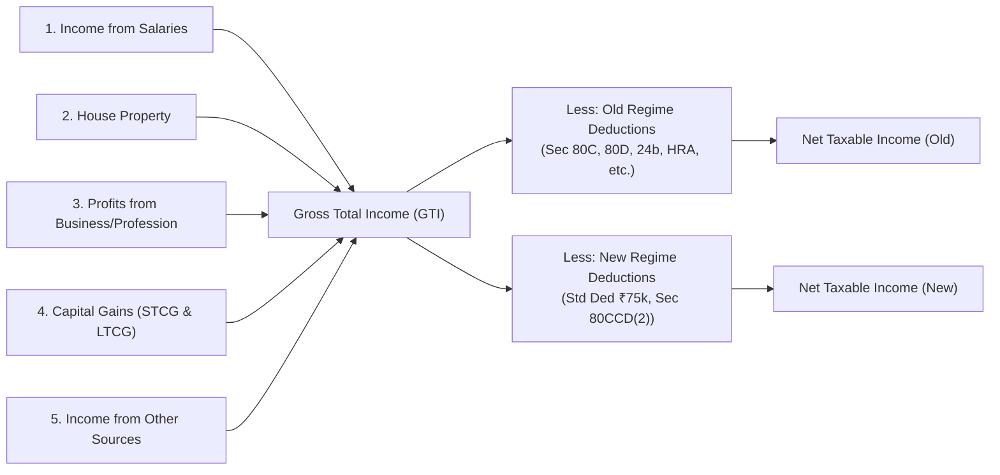
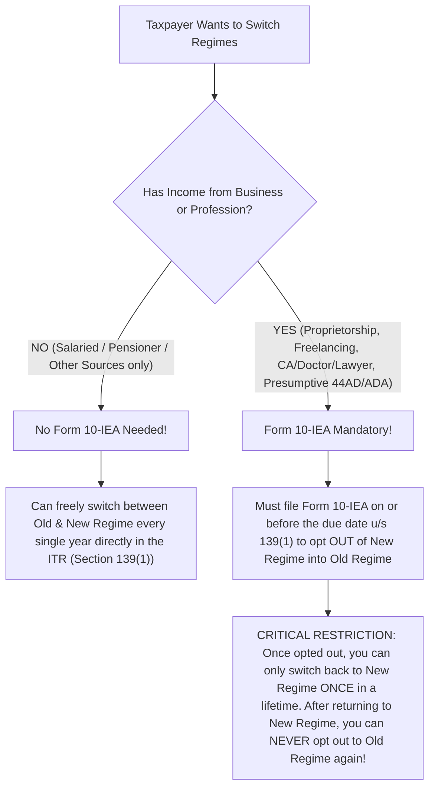

# BharatFiling — Income Tax Return (ITR) Slab Checker & Tax Regime Guide
**A Comprehensive CA-Reviewed Master Manual: WHY, HOW, and WHEN**

---

## Table of Contents
1. [Executive Overview](#1-executive-overview)
2. [THE WHY: Domain Rationale, Legislative Intent & Taxpayer Dilemma](#2-the-why-domain-rationale-legislative-intent--taxpayer-dilemma)
   - [2.1 Why Does the ITR Slab Checker Exist?](#21-why-does-the-itr-slab-checker-exist)
   - [2.2 Why Are There Multiple Financial Years (FY 2024-25, 2025-26, 2026-27)?](#22-why-are-there-multiple-financial-years)
   - [2.3 Why Section 115BAC (New Tax Regime)?](#23-why-section-115bac-new-tax-regime)
   - [2.4 Why the Old Regime Remains Critical for Certain Taxpayers](#24-why-the-old-regime-remains-critical-for-certain-taxpayers)
3. [THE HOW: Tax Architecture, Mathematical Formulations & Computation Engine](#3-the-how-tax-architecture-mathematical-formulations--computation-engine)
   - [3.1 How Taxable Income is Computed Across the 5 Heads](#31-how-taxable-income-is-computed-across-the-5-heads)
   - [3.2 How Slabs are Applied (New vs Old Comparison Matrix)](#32-how-slabs-are-applied-new-vs-old-comparison-matrix)
   - [3.3 How Section 87A Rebate Operates](#33-how-section-87a-rebate-operates)
   - [3.4 How Section 87A Marginal Relief Works (Mathematical Proof)](#34-how-section-87a-marginal-relief-works-mathematical-proof)
   - [3.5 How Surcharges & Surcharge Marginal Relief are Calculated](#35-how-surcharges--surcharge-marginal-relief-are-calculated)
   - [3.6 How Special Rate Incomes (Capital Gains & Casual Income) are Treated](#36-how-special-rate-incomes-are-treated)
   - [3.7 How Health & Education Cess (4%) and Section 288B Rounding Work](#37-how-health--education-cess-4-and-section-288b-rounding-work)
4. [THE WHEN: Deadlines, Form 10-IEA, Breakeven Analysis & ITR Form Selection](#4-the-when-deadlines-form-10-iea-breakeven-analysis--itr-form-selection)
   - [4.1 When to Choose New Regime vs Old Regime (Breakeven Analysis)](#41-when-to-choose-new-regime-vs-old-regime-breakeven-analysis)
   - [4.2 When and How to File Form 10-IEA (Salaried vs Business Individuals)](#42-when-and-how-to-file-form-10-iea)
   - [4.3 When to Use Which ITR Form (ITR-1, ITR-2, ITR-3, ITR-4 Decision Matrix)](#43-when-to-use-which-itr-form)
   - [4.4 When Key Statutory Filing & Advance Tax Deadlines Occur](#44-when-key-statutory-filing--advance-tax-deadlines-occur)
5. [Technical Architecture & Integration in BharatFiling](#5-technical-architecture--integration-in-bharatfiling)

---

## 1. Executive Overview

The **BharatFiling ITR Slab Checker & Income Tax Calculator** (`/tools/income-tax-calculator`) is an institutional-grade financial computation engine designed for Indian taxpayers, Chartered Accountants, tax consultants, and enterprise payroll teams.

Its core objective is to deliver:
- **Instant side-by-side tax liability estimation** comparing the **Old Tax Regime** with the **New Tax Regime (Section 115BAC)**.
- **Dynamic rule switching** across **Financial Year (FY) 2026-27 (AY 2027-28)**, **FY 2025-26 (AY 2026-27)**, and **FY 2024-25 (AY 2025-26)**.
- **Mathematically rigorous marginal relief algorithms** for both Section 87A (rebate threshold relief) and high-net-worth surcharges (Section 115BAC / Section 112 / Section 111A).
- **Automated ITR Form advisory** recommending whether the taxpayer must file **ITR-1 (Sahaj)**, **ITR-2**, **ITR-3**, or **ITR-4 (Sugam)**.
- **Exportable, CA-formatted A4 computation reports** suitable for tax audit preparation, employer declaration verification (Form 12BB), and personal wealth planning.

---

## 2. THE WHY: Domain Rationale, Legislative Intent & Taxpayer Dilemma

### 2.1 Why Does the ITR Slab Checker Exist?
Indian tax law has undergone its most dramatic transformation in decades. From Assessment Year 2024-25 onwards:
1. **The New Tax Regime under Section 115BAC became the default regime**.
2. If a taxpayer does nothing, taxes are computed automatically under the New Regime.
3. To claim exemptions like **House Rent Allowance (HRA u/s 10(13A))**, **Home Loan Interest (u/s 24(b))**, **Life Insurance & PPF (u/s 80C)**, and **Health Insurance (u/s 80D)**, taxpayers must actively exercise the option to switch to the Old Regime.

**The Taxpayer Dilemma:**
- Most salaried employees either blindly stay in the default New Regime (overpaying taxes if they have significant rent or home loan deductions) or blindly stick to the Old Regime out of habit (overpaying taxes because they do not realize the New Regime offers lower rates, ₹75,000 standard deduction, and zero tax up to ₹12.75 Lakh).
- BharatFiling's ITR Slab Checker eliminates this guesswork with exact mathematical certainty.

---

### 2.2 Why Are There Multiple Financial Years?

| Financial Year (FY) | Assessment Year (AY) | Core Legislative Context |
|---|---|---|
| **FY 2024-25** | **AY 2025-26** | Budget 2024 enhanced the standard deduction to **₹75,000** for New Regime and widened the 5% slab from ₹3L–₹6L to **₹3L–₹7L**. Capital gains tax rates were restructured effective **23 July 2024**. |
| **FY 2025-26** | **AY 2026-27** | Budget 2025 (Finance Act 2025) replaced the New Regime slabs with a 7-slab structure (nil up to ₹4,00,000, 30% above ₹24,00,000) and raised the Section 87A rebate to ₹60,000 for taxable income up to ₹12,00,000, so a salaried taxpayer with up to ₹12,75,000 gross pays no tax. Surcharge cap of 25% continues under New Regime. |
| **FY 2026-27** | **AY 2027-28** | Budget 2026 left the New Regime slabs and the ₹60,000 rebate unchanged. The Income-tax Act, 2025 replaces the 1961 Act from 1 April 2026 (tax year 2026-27) and the slab rates carry over. |

Tax rules cannot be hardcoded into one static formula. A tax computation performed for income earned in FY 2024-25 must obey the rules of AY 2025-26, while payroll withholding for FY 2025-26 or FY 2026-27 must apply prospective statutory provisions.

---

### 2.3 Why Section 115BAC (New Tax Regime)?
The Government of India introduced Section 115BAC with four key goals:
1. **Simplification:** Eliminate cumbersome paperwork, rent receipt verification, and investment proof collection (Form 12BB) for millions of salaried workers.
2. **Lower Nominal Slab Rates:** Progressive tax rates starting at 5% with smaller rate bumps (5%, 10%, 15%, 20%, 25%, 30%) instead of jumping directly from 5% to 20% to 30%.
3. **Liquidity in Hands of Citizens:** Discourage forced illiquid investments in long-term lock-in products solely for tax savings, encouraging capital allocation based on financial merit.
4. **Higher Surcharge Cap:** The highest surcharge rate was cut from **37%** (Old Regime) to **25%** (New Regime), lowering the peak effective tax rate for high earners from ~**42.74%** down to ~**39%**.

---

### 2.4 Why the Old Regime Remains Critical for Certain Taxpayers
The Old Tax Regime remains substantially superior for taxpayers who have:
1. **Substantial Home Loan Interest (Section 24(b)):** Deduction up to **₹2,00,000** for self-occupied property, plus uncapped interest for rented-out properties (subject to ₹2L inter-head set-off).
2. **Significant HRA Claims (Section 10(13A)):** Especially in metro cities (Mumbai, Delhi, Kolkata, Chennai and, from FY 2026-27, Bengaluru, Hyderabad, Pune, Ahmedabad) where annual rent paid can generate exemptions of ₹2 Lakh to ₹5 Lakh+.
3. **Family Healthcare Expenses (Section 80D):** Up to **₹1,00,000** deduction if covering self, family, and senior citizen parents with medical insurance and preventive health checkups.
4. **Combined Deductions Exceeding the Breakeven Threshold:** If aggregate exemptions & Chapter VI-A deductions exceed roughly **₹5.5 Lakh to ₹8 Lakh** (depending on gross income bracket, FY 2025-26 onwards), the Old Regime reliably yields lower tax.

---

## 3. THE HOW: Tax Architecture, Mathematical Formulations & Computation Engine

### 3.1 How Taxable Income is Computed Across the 5 Heads

The engine computes income through the 5 statutory heads defined under Section 14 of the Income-tax Act:



#### Deductions Comparison Matrix
| Statutory Section | Deduction Description | Old Tax Regime | New Tax Regime (Sec 115BAC) |
|---|---|---|---|
| **Section 16(ia)** | Standard Deduction (Salaried/Pensioners) | **₹50,000** | **₹75,000** (from FY 2024-25 onwards) |
| **Section 57(iia)** | Family Pension Standard Deduction | Up to ₹15,000 or 1/3rd | Up to **₹25,000** or 1/3rd |
| **Section 10(13A)** | House Rent Allowance (HRA) | **Full Rule 2A Exemption** | **NIL** (Not Allowed) |
| **Section 10(5)** | Leave Travel Allowance (LTA) | **Allowed** | **NIL** (Not Allowed) |
| **Section 24(b)** | Interest on Home Loan (Self-Occupied) | Up to **₹2,00,000** | **NIL** (Not Allowed) |
| **Section 80C** | EPF, PPF, ELSS, LIC, Tuition Fees, Principal | Up to **₹1,50,000** | **NIL** (Not Allowed) |
| **Section 80CCD(1B)** | Additional NPS (Self Contribution) | Up to **₹50,000** | **NIL** (Not Allowed) |
| **Section 80CCD(2)** | Employer's Contribution to NPS | Up to 10% (14% for Govt) | **Allowed** (Up to 10% / 14% of Salary) |
| **Section 80D** | Health Insurance & Medical Checkup | Up to **₹1,00,000** | **NIL** (Not Allowed) |
| **Section 80E** | Interest on Higher Education Loan | **Actual without limit** | **NIL** (Not Allowed) |
| **Section 80G** | Donations to Approved Charities | 50% or 100% of donation | **NIL** (Not Allowed) |
| **Section 80TTA / 80TTB** | Savings Bank / Senior Deposit Interest | ₹10,000 / ₹50,000 | **NIL** (Not Allowed) |

---

### 3.2 How Slabs are Applied (New vs Old Comparison Matrix)

#### New Tax Regime (Section 115BAC — Default) for FY 2025-26 and FY 2026-27
*Uniform across all age groups (Individuals, Seniors, Super Seniors). Slabs introduced by the Finance Act 2025 and left unchanged by Budget 2026.*

| Taxable Income Slab | Tax Rate | Calculation Formula | Cumulative Tax |
|---|---|---|---|
| **₹0 to ₹4,00,000** | **Nil** | ₹0 | ₹0 |
| **₹4,00,001 to ₹8,00,000** | **5%** | $5\% \times (\text{Income} - 4,00,000)$ | ₹20,000 |
| **₹8,00,001 to ₹12,00,000** | **10%** | $₹20,000 + 10\% \times (\text{Income} - 8,00,000)$ | ₹60,000 |
| **₹12,00,001 to ₹16,00,000** | **15%** | $₹60,000 + 15\% \times (\text{Income} - 12,00,000)$ | ₹1,20,000 |
| **₹16,00,001 to ₹20,00,000** | **20%** | $₹1,20,000 + 20\% \times (\text{Income} - 16,00,000)$ | ₹2,00,000 |
| **₹20,00,001 to ₹24,00,000** | **25%** | $₹2,00,000 + 25\% \times (\text{Income} - 20,00,000)$ | ₹3,00,000 |
| **Above ₹24,00,000** | **30%** | $₹3,00,000 + 30\% \times (\text{Income} - 24,00,000)$ | Slab-based |

#### New Tax Regime for FY 2024-25 (AY 2025-26)

| Taxable Income Slab | Tax Rate | Cumulative Tax |
|---|---|---|
| **₹0 to ₹3,00,000** | **Nil** | ₹0 |
| **₹3,00,001 to ₹7,00,000** | **5%** | ₹20,000 |
| **₹7,00,001 to ₹10,00,000** | **10%** | ₹50,000 |
| **₹10,00,001 to ₹12,00,000** | **15%** | ₹80,000 |
| **₹12,00,001 to ₹15,00,000** | **20%** | ₹1,40,000 |
| **Above ₹15,00,000** | **30%** | Slab-based |

#### Old Tax Regime Slabs (Categorized by Age)
- **Category 1: Individuals (< 60 years):** Basic exemption ₹2,50,000.
- **Category 2: Senior Citizens (60 to 79 years):** Basic exemption ₹3,00,000.
- **Category 3: Super Senior Citizens (80+ years):** Basic exemption ₹5,00,000.

| Taxable Income Bracket | Rate (< 60 Yrs) | Rate (60 to 79 Yrs) | Rate (80+ Yrs) |
|---|---|---|---|
| **₹0 to ₹2,50,000** | Nil | Nil | Nil |
| **₹2,50,001 to ₹3,00,000** | 5% | Nil | Nil |
| **₹3,00,001 to ₹5,00,000** | 5% | 5% | Nil |
| **₹5,00,001 to ₹10,00,000** | 20% | 20% | 20% |
| **Above ₹10,00,000** | 30% | 30% | 30% |

---

### 3.3 How Section 87A Rebate Operates

Section 87A provides a statutory tax credit to low- and middle-income resident individuals:

1. **Under Old Regime:**
   - Eligibility: Total Taxable Income $\le ₹5,00,000$.
   - Maximum Rebate: $\min(\text{Tax Payable}, ₹12,500)$.
   - Result: Any resident individual earning up to ₹5,00,000 pays **₹0** tax.
2. **Under New Regime (Section 115BAC) — FY 2025-26 and FY 2026-27:**
   - Eligibility: Total Taxable Income $\le ₹12,00,000$.
   - Maximum Rebate: $\min(\text{Tax Payable}, ₹60,000)$.
   - Result: Any resident individual with taxable income up to ₹12,00,000 pays **₹0** tax.
   - *Impact on Salaried Individuals:* Gross salary of ₹12,75,000 minus ₹75,000 standard deduction equals ₹12,00,000 taxable income $\implies$ **₹0 Tax**.
   - *Not available against special-rate income:* the rebate only offsets tax on ordinary slab income. Tax on capital gains u/s 111A, 112 and 112A is payable in full.
3. **Under New Regime for FY 2024-25:** the limit was ₹7,00,000 taxable income and the maximum rebate ₹25,000 (zero tax up to ₹7,75,000 gross salary).

---

### 3.4 How Section 87A Marginal Relief Works (Mathematical Proof)

A critical flaw in basic calculators is the failure to handle the **"Section 87A Tax Cliff"**.

#### The Problem (FY 2025-26 / FY 2026-27):
- At taxable income of **₹12,00,000**, tax is ₹60,000 minus ₹60,000 rebate = **₹0**.
- If taxable income increases by just **₹1,000** to **₹12,01,000**, normal tax without relief jumps to:
  $$\text{Tax} = 5\% \times 4,00,000 + 10\% \times 4,00,000 + 15\% \times 1,000 = 20,000 + 40,000 + 150 = ₹60,150$$
  *The taxpayer earned ₹1,000 extra but would have to pay ₹60,150 in tax!*

#### The Statutory Remedy (Proviso to Section 87A under Finance Act):
The law mandates that the tax payable shall not exceed the amount by which total taxable income exceeds ₹12,00,000:
$$\text{Tax Payable (before cess)} \le \text{Taxable Income} - 12,00,000$$
$$\text{Section 87A Marginal Relief} = \max(0, \text{Normal Slab Tax} - (\text{Taxable Income} - 12,00,000))$$

#### Exact Mathematical Cutoff Derivation:
Let $Y = \text{Taxable Income} - 12,00,000$. In the 15% slab ($12,00,000 < \text{Income} \le 16,00,000$):
$$\text{Normal Slab Tax} = ₹60,000 + 0.15 \times Y$$
Marginal relief applies as long as:
$$\text{Normal Slab Tax} > Y \iff 60,000 + 0.15 Y > Y \iff 60,000 > 0.85 Y \iff Y < \frac{60,000}{0.85} \approx 70,588.24$$
Therefore, **Marginal Relief applies up to Taxable Income of ₹12,70,588**.
*(For FY 2024-25 the same mechanism applied around the ₹7,00,000 limit, with relief up to ₹7,22,222.)*

#### Worked Example:
- **Taxable Income:** ₹12,10,000.
- **Normal Slab Tax:** $₹60,000 + 15\% \times 10,000 = ₹61,500$.
- **Excess Income over ₹12,00,000:** $₹12,10,000 - ₹12,00,000 = ₹10,000$.
- **Section 87A Marginal Relief:** $₹61,500 - ₹10,000 = ₹51,500$.
- **Tax Payable after Relief:** $₹61,500 - ₹51,500 = ₹10,000$.
- **Plus 4% Cess:** $₹10,000 \times 1.04 = \mathbf{₹10,400}$ *(instead of ₹63,960)*.

---

### 3.5 How Surcharges & Surcharge Marginal Relief are Calculated

For high-net-worth individuals (HNIs), surcharge is levied on income tax:

| Total Income Bracket | Old Regime Surcharge | New Regime Surcharge |
|---|---|---|
| **₹50 Lakh to ₹1 Crore** | 10% | 10% |
| **₹1 Crore to ₹2 Crore** | 15% | 15% |
| **₹2 Crore to ₹5 Crore** | 25% | 25% |
| **Above ₹5 Crore** | **37%** | **Capped at 25%** |

#### Surcharge Marginal Relief Formulation:
When total income marginally crosses a surcharge threshold $T$ (e.g., ₹50 Lakh), the total tax plus surcharge payable must not exceed:
$$\text{Cap} = [\text{Tax on threshold } T \text{ (including any applicable surcharge at } T)] + (\text{Total Income} - T)$$
$$\text{Surcharge Marginal Relief} = \max(0, (\text{Tax} + \text{Surcharge}) - \text{Cap})$$

---

### 3.6 How Special Rate Incomes are Treated

Certain income types cannot be taxed at ordinary slab rates and are segregated before applying slabs:

1. **Short-Term Capital Gains u/s 111A (Listed Equity / Equity MF):**
   - Pre-July 23, 2024: 15%
   - Post-July 23, 2024 (Budget 2024): **20%**
2. **Long-Term Capital Gains u/s 112A (Listed Equity / Equity MF):**
   - Pre-July 23, 2024: 10% on gains exceeding ₹1,00,000.
   - Post-July 23, 2024 (Budget 2024): **12.5%** on gains exceeding **₹1,25,000**.
3. **Other Long-Term Capital Gains u/s 112 (Real Estate, Gold, Unlisted Shares):**
   - Revised to **12.5%** without indexation (with transition grandfathering provisions for real estate acquired before July 23, 2024).
4. **Lottery / Online Gaming / Betting u/s 115BB / 115BBJ:**
   - Flat **30%** without any slab exemption, standard deduction, or Chapter VI-A deductions.

*Basic Exemption Adjustment:* If ordinary income is less than the basic exemption limit (e.g. ₹2.5L / ₹3L under the Old Regime, ₹4L under the New Regime), the unexhausted basic exemption is offset against capital gains for resident individuals before computing tax.

---

### 3.7 How Health & Education Cess (4%) and Section 288B Rounding Work

1. **Health and Education Cess:**
   $$\text{Cess} = 4\% \times (\text{Income Tax Payable after Rebates and Reliefs} + \text{Net Surcharge})$$
2. **Total Tax Liability:**
   $$\text{Gross Tax Liability} = \text{Tax Payable} + \text{Surcharge} + \text{Cess}$$
3. **Section 288B Rounding Off:**
   The final amount of tax payable or refund due is rounded to the **nearest multiple of ₹10** (if the last digit is ₹5 or more, rounded up; otherwise rounded down).

---

## 4. THE WHEN: Deadlines, Form 10-IEA, Breakeven Analysis & ITR Form Selection

### 4.1 When to Choose New Regime vs Old Regime (Breakeven Analysis)

Taxpayers should choose the regime that minimizes their tax. The decision boils down to whether the taxpayer's **eligible deductions exceed the breakeven deduction threshold**.

```
                           BREAKEVEN FORMULA
    If (Eligible Deductions under Old Regime) > (Breakeven Threshold)
                       ===> Choose OLD REGIME
                                Otherwise
                       ===> Choose NEW REGIME
```

#### Breakeven Deductions Guide (FY 2025-26 / FY 2026-27):
*Deductions = Old Regime exemptions and deductions over and above the ₹50,000 standard deduction (HRA, 80C, 80D, home loan interest u/s 24(b), etc.).*

| Gross Salary Level | New Regime Tax (incl. cess) | Deductions Required to Match in Old Regime | CA Recommendation |
|---|---|---|---|
| **Up to ₹12,75,000** | **₹0** | Not applicable | **100% New Regime** (Tax is already zero). |
| **₹15,00,000** | ₹97,500 | **≈ ₹5,45,000** | **New Regime** unless you have heavy rent + home loan + 80C + 80D claims. |
| **₹20,00,000** | ₹1,92,400 | **≈ ₹7,10,000** | **New Regime** for most; Old Regime needs ₹7.1L+ of deductions. |
| **₹25,00,000** | ₹3,19,800 | **≈ ₹8,00,000** | **Old Regime** only with very large HRA / home loan claims. |
| **₹50,00,000+** | ₹10,99,800 (at ₹50L) | **≈ ₹8,00,000** | **New Regime** is usually superior, especially with 25% surcharge cap. |

---

### 4.2 When and How to File Form 10-IEA

One of the most frequent CA compliance queries is regarding **Form 10-IEA**:



#### Summary Rules for Form 10-IEA:
- **Salaried Individuals (No business income):** Form 10-IEA is **NOT required**. Simply check the box for Old Regime or New Regime while filing ITR-1 or ITR-2 before the due date.
- **Business Individuals / Professionals (ITR-3 or ITR-4):** Form 10-IEA **MUST be submitted electronically** before filing the return. Filing ITR after the deadline automatically forces the New Regime.

---

### 4.3 When to Use Which ITR Form

The calculator includes an automated **ITR Form Advisor** that inspects user incomes:

```
+----------------------------------------------------------------------------------------------------+
|                                      ITR SELECTION MATRIX                                          |
+----------+----------------------------------------------+--------------------+---------------------+
| ITR Form | Eligible Taxpayers                           | Maximum Income     | Permitted Heads     |
+----------+----------------------------------------------+--------------------+---------------------+
| ITR-1    | Resident Individuals                         | Up to ₹50 Lakh     | Salary (1 employer),|
| (Sahaj)  | (Not applicable for Directors, Unlisted      |                    | 1 House Property,   |
|          | Share holders, or Foreign Asset owners)      |                    | Other Sources       |
|          |                                              |                    | (Agri <= ₹5k)       |
+----------+----------------------------------------------+--------------------+---------------------+
| ITR-2    | Individuals & HUFs WITHOUT Business Income   | No Limit           | Salary, Multiple    |
|          | (Has Capital Gains, Foreign Assets,          |                    | Properties, Capital |
|          | Directorship, or Unlisted Shares)            |                    | Gains, Other Sources|
+----------+----------------------------------------------+--------------------+---------------------+
| ITR-3    | Individuals & HUFs WITH Business/Profession  | No Limit           | All 5 heads,        |
|          | (Proprietorships, Partner in a firm,         |                    | audited/unaudited   |
|          | Freelancers with books of accounts)          |                    | business income     |
+----------+----------------------------------------------+--------------------+---------------------+
| ITR-4    | Resident Individuals, HUFs & Small Firms     | Up to ₹50 Lakh     | Presumptive Business|
| (Sugam)  | opting for Presumptive Taxation u/s          |                    | (44AD, 44ADA, 44AE) |
|          | 44AD, 44ADA, or 44AE                         |                    | + Salary + 1 HP     |
+----------+----------------------------------------------+--------------------+---------------------+
```

---

### 4.4 When Key Statutory Filing & Advance Tax Deadlines Occur

#### 1. Annual ITR Filing Deadlines:
- **July 31st (of Assessment Year):** Due date for salaried individuals, non-audit business cases, and HUFs.
- **October 31st (of Assessment Year):** Due date for businesses and professionals subject to Tax Audit under Section 44AB.
- **November 30th (of Assessment Year):** Due date for taxpayers required to submit a Transfer Pricing report (Form 3CEB).
- **December 31st (of Assessment Year):** Last date to file a **Belated Return (Section 139(4))** or **Revised Return (Section 139(5))** with late fees u/s 234F.

#### 2. Advance Tax Payment Schedule (Section 208 / 211):
*Applicable if net tax payable after TDS exceeds ₹10,000 in the financial year.*
- **On or before June 15:** 15% of advance tax.
- **On or before September 15:** 45% of advance tax.
- **On or before December 15:** 75% of advance tax.
- **On or before March 15:** 100% of advance tax.
- *(Presumptive 44AD/44ADA taxpayers can pay 100% in a single installment by March 15).*

---

## 5. Technical Architecture & Integration in BharatFiling

### 5.1 Route and Component Tree
- **Public URL:** `https://bharatfiling.org/tools/income-tax-calculator`
- **Route Definition (`frontend/src/App.jsx`):** Mounted inside `<MainLayout />` with standard header clearance (`pt-[68px]`).
- **Header Mega-Menu (`navigationData.js`):** Featured directly under the *Income Tax* category alongside the *HRA Calculator*.
- **Client-Side Engine:** `frontend/src/utils/incomeTaxEngine.js` for real-time reactivity without network lag.
- **Backend API:** `POST /api/v1/tools/income-tax/calculate` backed by `backend/src/modules/incomeTax/` with Zod validation.

### 5.2 Legal & Statutory Disclaimers
The calculator prominently displays:
> **Statutory Disclaimer:** This Income Tax Calculator and ITR Slab Checker is designed solely for preliminary tax estimation and comparative analysis under the Income-tax Act, 1961 and applicable Finance Acts. It does not constitute a legal tax assessment, final tax return filing, or formal tax advice. Actual tax liability depends on verified documentation, departmental circulars, Form 26AS/AIS/TIS records, and individual assessment. Taxpayers are advised to consult a qualified Chartered Accountant before filing their return.

---

*Compiled by the BharatFiling Product & Taxation Engineering Team.*  
*Maintained in repository root: `ITR_SLAB_CHECKER.md`.*
